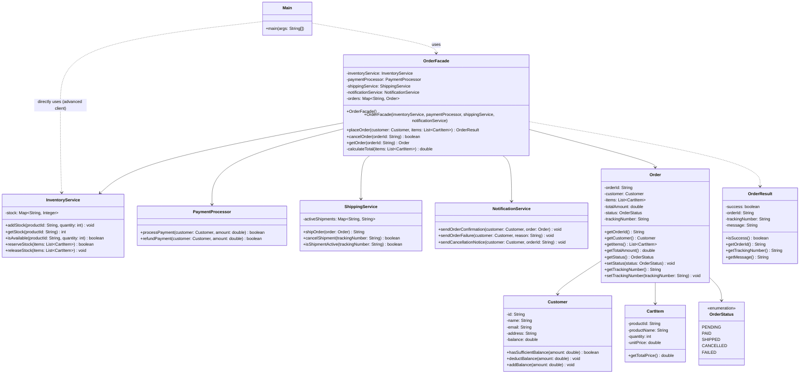

# Assignment 4: Facade Pattern Report

**Student:** Muratbek Akyl  
**Group:** SE 2523  

---

## 1. Introduction

For this assignment, I implemented the **Online Order Processing Facade** (Option B). 

In modern e-commerce systems, completing a single purchase requires coordinating several independent domain services:
1. `InventoryService`: Verifying item availability, holding/reserving quantities, and restocking.
2. `PaymentProcessor`: Validating customer funds, charging accounts, and issuing refunds.
3. `ShippingService`: Creating parcel shipments, generating unique tracking numbers, and cancelling transit.
4. `NotificationService`: Sending email/SMS alerts to customers regarding order status.

### Why this subsystem needs a Facade
Without a Facade, any client (such as a web checkout controller, a mobile app backend, or a point-of-sale terminal) would have to manually instantiate and orchestrate all four services. The client would be burdened with:
- Managing the exact sequence of operations (e.g., reserving stock before charging money, shipping only after successful payment).
- Handling step failures and executing complex compensation/rollback logic (e.g., releasing reserved inventory if payment fails).
- Direct coupling to the concrete APIs and data structures of four distinct subsystems.

By introducing `OrderFacade`, all orchestration, dependency sequencing, and rollback mechanics are encapsulated behind clean, high-level methods: `placeOrder(customer, cartItems)` and `cancelOrder(orderId)`.

---

## 2. UML Class Diagram



---

## 3. Clean Code Section

### Principle 1: Meaningful Names
**Justification:** Method and variable names should clearly express their intent and business context, eliminating ambiguity and removing the need for explanatory comments.

- **Before (unclear, cryptic naming):**
```java
public OrderResult proc(Customer c, List<CartItem> it) {
    boolean ok = inv.res(it);
    if (!ok) return OrderResult.fail();
    double t = calc(it);
    boolean p = pay.pay(c, t);
    ...
}
```

- **After (self-explanatory, intention-revealing naming in `OrderFacade`):**
```java
public OrderResult placeOrder(Customer customer, List<CartItem> items) {
    boolean stockReserved = inventoryService.reserveStock(items);
    if (!stockReserved) {
        notificationService.sendOrderFailure(customer, "Insufficient stock for requested items");
        return OrderResult.failure("Insufficient stock for requested items");
    }
    double totalAmount = calculateTotal(items);
    boolean paymentApproved = paymentProcessor.processPayment(customer, totalAmount);
    ...
}
```

---

### Principle 2: Single Responsibility Principle (SRP)
**Justification:** A class should have only one reason to change. The Facade is responsible strictly for orchestrating operations between subsystems. It does not calculate shipping rates, generate gateway signatures, or manipulate inventory structures directly.

- **Before (Facade violates SRP by doing actual subsystem calculations):**
```java
public class OrderFacade {
    private Map<String, Integer> stock = new HashMap<>();

    public void placeOrder(Customer customer, List<CartItem> items) {
        for (CartItem item : items) {
            stock.put(item.getProductId(), stock.get(item.getProductId()) - item.getQuantity());
        }
        customer.setBalance(customer.getBalance() - 100);
        // Direct manipulation of inventory and customer internals
    }
}
```

- **After (Facade delegates each responsibility to dedicated subsystem services):**
```java
public class OrderFacade {
    private final InventoryService inventoryService;
    private final PaymentProcessor paymentProcessor;
    private final ShippingService shippingService;
    private final NotificationService notificationService;

    public OrderResult placeOrder(Customer customer, List<CartItem> items) {
        inventoryService.reserveStock(items);
        paymentProcessor.processPayment(customer, totalAmount);
        shippingService.shipOrder(order);
        notificationService.sendOrderConfirmation(customer, order);
        ...
    }
}
```

---

### Principle 3: No Leaking of Subsystem Details (Encapsulation)
**Justification:** The Facade's public API must not expose internal subsystem primitives, locks, or implementation specifics. The client interacts with domain concepts (`Customer`, `CartItem`, `OrderResult`), remaining completely decoupled from how shipping labels or payment transactions are formed.

- **Before (leaking subsystem details to client):**
```java
// Client must know about internal shipment hashes and payment gateway tokens
public GatewayTransactionToken placeOrder(Customer c, List<CartItem> items, InternalCarrierRoutingCode code);
```

- **After (clean public contract via `OrderResult`):**
```java
public OrderResult placeOrder(Customer customer, List<CartItem> items) {
    ...
    return OrderResult.success(orderId, trackingNumber, "Order successfully processed and shipped");
}
```

---

### Principle 4: Small, Focused Subsystem Classes
**Justification:** Each subsystem class handles a concise, coherent set of behaviors. Classes are short, readable, and have high cohesion.

- **Annotated Excerpt (`PaymentProcessor.java`):**
```java
public class PaymentProcessor {
    public boolean processPayment(Customer customer, double amount) {
        if (customer == null || amount <= 0) {
            return false;
        }
        if (!customer.hasSufficientBalance(amount)) {
            System.out.printf("[PaymentProcessor] Payment of $%.2f DECLINED for customer %s (Balance: $%.2f)%n",
                    amount, customer.getName(), customer.getBalance());
            return false;
        }
        customer.deductBalance(amount);
        System.out.printf("[PaymentProcessor] Payment of $%.2f APPROVED for customer %s (Remaining balance: $%.2f)%n",
                amount, customer.getName(), customer.getBalance());
        return true;
    }

    public boolean refundPayment(Customer customer, double amount) {
        if (customer == null || amount <= 0) {
            return false;
        }
        customer.addBalance(amount);
        System.out.printf("[PaymentProcessor] Refund of $%.2f PROCESSED for customer %s (Updated balance: $%.2f)%n",
                amount, customer.getName(), customer.getBalance());
        return true;
    }
}
```
*The class is under 35 lines, does only payment processing and refunding, and has zero unnecessary dependencies.*

---

### Principle 5: Proper Error Handling and Rollback Mechanism
**Justification:** When orchestrating distributed or multi-step operations, failure at any intermediate step must leave the system in a consistent state. If payment fails after stock is reserved, that stock must be released back.

- **Before (unhandled failure leading to inconsistent state):**
```java
inventoryService.reserveStock(items);
boolean paid = paymentProcessor.processPayment(customer, total);
if (!paid) {
    return false; // BUG: Stock remains reserved forever!
}
```

- **After (automatic compensation rollback in `OrderFacade`):**
```java
boolean stockReserved = inventoryService.reserveStock(items);
if (!stockReserved) {
    notificationService.sendOrderFailure(customer, "Insufficient stock for requested items");
    return OrderResult.failure("Insufficient stock for requested items");
}

double totalAmount = calculateTotal(items);
boolean paymentApproved = paymentProcessor.processPayment(customer, totalAmount);
if (!paymentApproved) {
    inventoryService.releaseStock(items);
    notificationService.sendOrderFailure(customer, "Payment was declined");
    return OrderResult.failure("Payment was declined; reserved stock has been released");
}
```

---

## 4. Conclusion

### What the Facade Hides
- The ordering and timing of subsystem calls (reserve stock $\rightarrow$ charge payment $\rightarrow$ dispatch shipment $\rightarrow$ notify customer).
- The compensation and rollback logic when a step fails midway.
- Tracking number generation and shipment tracking state mappings.
- Reversal workflow during order cancellation (cancelling shipping label, refunding funds, restocking items, and sending cancellation notice).

### What Remains Directly Accessible
- All subsystem classes (`InventoryService`, `PaymentProcessor`, `ShippingService`, `NotificationService`) have public methods and maintain zero back-references to `OrderFacade`.
- Advanced or specialized clients can bypass the Facade whenever necessary:
  - The warehouse staff can access `InventoryService.addStock()` or `InventoryService.getStock()` directly.
  - The accounting department can interact with `PaymentProcessor` directly for manual reconciliations.
  - Logistics teams can query `ShippingService.isShipmentActive()` directly.

---

## 5. Repository Link
- **GitHub Repository:** [https://github.com/Akylsolo/SDP_Assignment4](https://github.com/Akylsolo/SDP_Assignment4)
